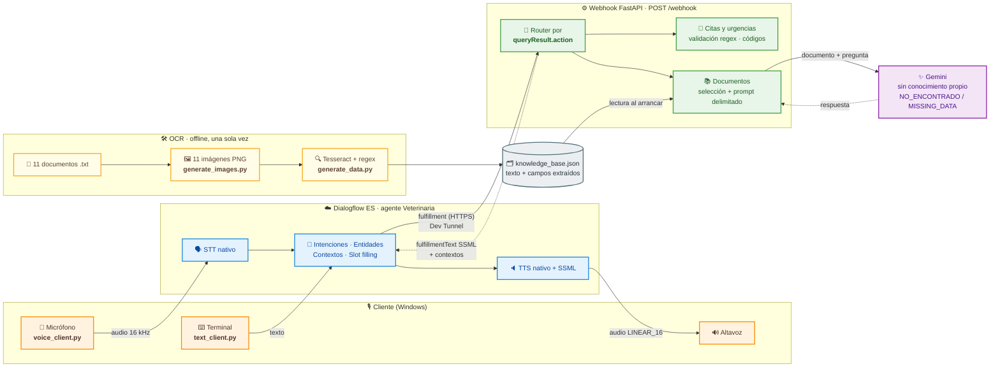
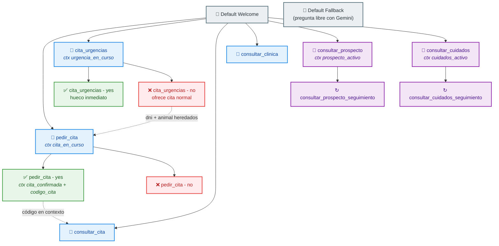
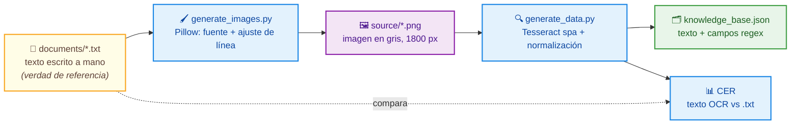
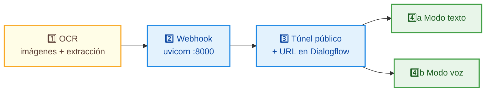

# 🐾 Veterinaria — asistente de voz para una clínica veterinaria

**Autor:** Raúl Sánchez Serrano · [@RaulRX](https://github.com/RaulRX)
**Agente de Dialogflow ES:** `Veterinaria` (idioma `es`, zona horaria `Europe/Madrid`)
**Asignatura:** Herramientas de IA Clásica — Máster en Inteligencia Artificial, Cloud Computing y DevOps (evaluación final)


---

## 📋 Índice

1. [Caso de uso](#-caso-de-uso)
2. [Qué hace el agente](#-qué-hace-el-agente)
3. [Arquitectura](#-arquitectura)
4. [Intenciones](#-intenciones)
5. [Entidades](#-entidades)
6. [Contextos y flujos multi-turno](#-contextos-y-flujos-multi-turno)
7. [OCR y respuesta documental](#-ocr-y-respuesta-documental)
8. [Voz y SSML](#-voz-y-ssml)
9. [Decisiones técnicas](#-decisiones-técnicas)
10. [Instalación](#-instalación)
11. [Ejecución: orden y modos](#-ejecución-orden-y-modos)
12. [Tests](#-tests)
13. [Estructura del repositorio](#-estructura-del-repositorio)
14. [Limitaciones conocidas](#-limitaciones-conocidas)
15. [Vídeo de demostración](#-vídeo-de-demostración)

---

## 🩺 Caso de uso

**Veterinaria** es un asistente conversacional por voz para una clínica veterinaria ficticia. El usuario habla por el micrófono y el agente responde hablando: puede pedir una cita normal o una cita de urgencia (con un flujo de varios turnos que recoge DNI, animal, fecha y hora y termina con una confirmación sí/no), consultar una cita por su código, preguntar por horarios y dirección, y resolver dudas sobre **prospectos de medicamentos** y **guías de cuidados** de mascotas. Esas respuestas se apoyan en 11 documentos inventados que se procesan una sola vez con OCR (Tesseract); el webhook se los entrega como contexto a Gemini, que contesta únicamente con lo que dicen los documentos y admite explícitamente cuando no tiene información, en lugar de inventarla.

---

## 🎯 Qué hace el agente

| | Capacidad | Cómo funciona |
|---|---|---|
| 📅 | **Pedir cita** | Recoge `dni`, `animal`, `fecha` y `hora` (slot filling), valida los datos en el webhook, resume y pide confirmación. Si el usuario dice «sí», genera un código `VETnnnn` y lo deja en contexto |
| 🚨 | **Urgencias** | Recoge `dni`, `animal` y `sintoma`, hace un triaje (grave / leve / desconocido) y ofrece un hueco inmediato. Si el síntoma es leve y el usuario declina, puede pasar a una cita normal reutilizando `dni` y `animal` del contexto |
| 🔎 | **Consultar cita** | Por código (`VET0001`, «vet 0001»…). Si acabas de confirmar una cita en la misma conversación, no hace falta repetir el código |
| 🏥 | **Horarios e información** | Horario, dirección y teléfono de urgencias, con el teléfono locutado dígito a dígito |
| 💊 | **Prospectos** | Dosis, modo y tiempo de aplicación, contraindicaciones, efectos secundarios, conservación, caducidad… de 5 medicamentos. Admite preguntas de seguimiento («¿y para un gato?») |
| 🐶 | **Cuidados** | Alimentación, agua, ejercicio, vacunas, desparasitación, higiene, revisión y signos de alarma de 5 especies. También con seguimiento |
| ❓ | **Pregunta libre** | Cualquier cosa que no encaje en una intención cae en el fallback, que consulta los documentos con Gemini |
| 🛡️ | **Control de alucinaciones** | Si la respuesta no está en los documentos, el agente lo dice y anima a preguntar por algo relacionado |

### Ejemplo de conversación

```text
Agente  Hola, soy el asistente de la clínica veterinaria. Puedo pedir una cita, atender una
        urgencia, consultar una cita, darte los horarios o resolver dudas sobre medicamentos
        y cuidados. ¿En qué te ayudo?
Usuario Quiero pedir una cita para mi perro
Agente  ¿Cuál es tu DNI?
Usuario 12345678Z
Agente  ¿Para qué día?
Usuario El próximo lunes
Agente  ¿A qué hora?
Usuario A las diez de la mañana
Agente  Resumo: cita para tu perro, el lunes 26 de octubre a las 10:00, con DNI 1-2-3-4-5-6-7-8-Z.
        ¿Quieres que la confirme?
Usuario Sí
Agente  Hecho, tu cita para tu perro el lunes 26 de octubre a las 10:00 queda confirmada.
        Tu código es V-E-T-0-4-2-7.
Usuario ¿Qué dosis lleva el Doloxan?                       ← pregunta resuelta con los documentos
Agente  Según el prospecto, … (respuesta basada en el texto del OCR)
```

---

## 🏗️ Arquitectura



**Flujo de un turno:** el audio llega a Dialogflow, que lo transcribe, detecta la intención, rellena parámetros y contextos y llama al webhook. El webhook enruta por la *action* de la intención, valida, decide y devuelve texto SSML (más contextos de salida cuando procede). Dialogflow lo sintetiza y el cliente lo reproduce. El OCR queda **fuera** del camino en tiempo real: el webhook solo lee un JSON.

### Mapa de intenciones



---

## 🗣️ Intenciones

El enunciado pide 5-6 intenciones significativas más bienvenida y fallback. Las 6 principales son `pedir_cita`, `cita_urgencias`, `consultar_cita`, `consultar_clinica`, `consultar_prospecto` y `consultar_cuidados`; las subintenciones (sí/no y seguimientos) son parte de sus flujos.

| Intención | Action | Propósito | Webhook |
|---|---|---|:-:|
| `Default Welcome Intent` | `input.welcome` | Saludo y resumen de lo que sabe hacer | — |
| `Default Fallback Intent` | `input.unknown` | Si nada encaja, trata el texto como pregunta libre sobre los documentos | ✅ |
| `pedir_cita` | `cita.pedir` | Slot filling de `dni`, `animal`, `fecha`, `hora`; valida y pide confirmación | ✅ |
| `pedir_cita - yes` | `cita.pedir.si` | Confirma: genera `VETnnnn` y abre `cita_confirmada` | ✅ |
| `pedir_cita - no` | `cita.pedir.no` | Cancela y limpia el contexto de la cita | — |
| `cita_urgencias` | `cita.urgencia` | Slot filling de `dni`, `animal`, `sintoma`; triaje por gravedad | ✅ |
| `cita_urgencias - yes` | `cita.urgencia.si` | Acepta el hueco inmediato | — |
| `cita_urgencias - no` | `cita.urgencia.no` | Rechaza el hueco y propone una cita normal conservando `dni` y `animal` | — |
| `consultar_cita` | `cita.consultar` | Busca la cita por `codigo_cita` (contexto de la sesión o ejemplos) | ✅ |
| `consultar_clinica` | `clinica.info` | Horarios, dirección y teléfono 24 h | ✅ |
| `consultar_prospecto` | `prospecto.consultar` | Duda sobre un medicamento (`animal` obligatorio) | ✅ |
| `consultar_prospecto_seguimiento` | `prospecto.seguimiento` | Pregunta de continuación («¿y para un gato?») | ✅ |
| `consultar_cuidados` | `cuidados.consultar` | Duda sobre el cuidado de una especie (`animal` obligatorio) | ✅ |
| `consultar_cuidados_seguimiento` | `cuidados.seguimiento` | Pregunta de continuación | ✅ |

El webhook enruta por `queryResult.action`, no por el nombre de la intención: se puede renombrar una intención en la consola sin tocar el código (los nombres de las *actions* se configuran en `.env`).

---

## 🏷️ Entidades

| Entidad | Tipo | Contenido |
|---|---|---|
| `@DNI` | **Regexp** | DNI y NIE, mayúsculas o minúsculas, con un espacio opcional antes de la letra |
| `@codigo_cita` | **Regexp** | `(VET\|vet\|Vet)[\s-]?\d{4}` |
| `@animal` | Personalizada (map) | `perro`, `gato`, `conejo`, `huron`, `tortuga` |
| `@medicamento` | Personalizada (map) | `doloxan`, `vermiclear`, `pulgastop`, `otisan`, `zenpet` (nombres ficticios) |
| `@tema_prospecto` | Personalizada (map) | dosis, modo y tiempo de aplicación, contraindicaciones, efectos secundarios, conservación, caducidad, indicaciones |
| `@tema_cuidados` | Personalizada (map) | alimentación, agua, ejercicio, vacunas, desparasitación, higiene, revisión, signos de alarma |
| `@sintoma` | Personalizada (map, expansión automática) | 13 síntomas: convulsiones, sangrado, envenenamiento, atropello, no respira, desmayo, abdomen hinchado, vómito, diarrea, cojera, picor, estornudos, falta de apetito |
| `@sys.date`, `@sys.time` | Sistema | Fecha y hora de la cita |

El *fuzzy matching* está desactivado en todas las entidades (evita falsos positivos como «pero» → «perro»); la cobertura se consigue con sinónimos.

---

## 🔗 Contextos y flujos multi-turno

Los contextos son lo que hace que las intenciones «se hablen» entre sí:

| Contexto | Lo abre | Lleva | Para qué |
|---|---|---|---|
| `cita_en_curso` | `pedir_cita` | `dni`, `animal`, `fecha`, `hora` | Habilita el sí/no de la cita; sin él, un «sí» suelto no confirma nada |
| `cita_confirmada` | `pedir_cita - yes` | `codigo_cita` y los datos de la cita | `consultar_cita` lee de aquí el código sin pedirlo |
| `urgencia_en_curso` | `cita_urgencias` | `dni`, `animal`, `sintoma` | Habilita el sí/no de la urgencia; `pedir_cita` hereda `dni` y `animal` |
| `prospecto_activo` / `cuidados_activo` | las intenciones documentales | `medicamento`, `animal`, `tema` | Los seguimientos corta-frases heredan el tema |
| `pregunta_pendiente` | el webhook | la pregunta original | Cuando Gemini necesita un dato que falta (`MISSING_DATA:`), la siguiente respuesta corta («perro») completa la pregunta en lugar de lanzar otra intención |

Detalles que evitan colisiones: `pedir_cita` pone a 0 el `cita_urgencias-followup` (un «sí» durante una cita normal no activa la urgencia), y cada intención documental cierra el contexto del otro tipo para que no compitan los dos seguimientos.

---

## 🖼️ OCR y respuesta documental

### Por qué 11 documentos

El enunciado pide procesar entre 3 y 5 documentos; este proyecto procesa 11 de forma deliberada. El objetivo era tener un **abanico representativo** con el que el agente pudiera responder preguntas variadas de una clínica real, y que el sistema tuviera que *elegir* el documento correcto en lugar de recibir siempre el mismo:

| Categoría | Nº | Documentos | Qué aporta |
|---|:-:|---|---|
| Prospectos de medicamentos | 5 | Doloxan (antiinflamatorio), Vermiclear (antiparasitario interno), Pulgastop (antiparasitario externo), Otisan (otológico, solo perro), Zenpet (antibiótico) | Cubre distintos tipos de tratamiento, dosis por especie y contraindicaciones diferentes |
| Guías de cuidados | 5 | Perro, gato, conejo, hurón, tortuga | Cubre especies con necesidades muy distintas (mamíferos, exótico y reptil) |
| Información de la clínica | 1 | Horario, dirección y teléfono de urgencias | Permite responder «¿a qué hora abrís?» con el mismo mecanismo documental |

El procesamiento es el mismo para todos y se ejecuta una sola vez, así que el coste de ampliar el abanico es nulo en tiempo de ejecución: el webhook solo envía a Gemini el documento que corresponde a cada pregunta.

### Cómo se generan las imágenes

El enunciado exige procesar documentos con OCR, pero no se podían usar prospectos reales (derechos y datos de medicamentos reales). Por eso las «fotos» de los documentos se **fabrican por script**, de forma reproducible y con una *verdad de referencia* (*ground truth*) con la que medir el OCR:



1. **Texto de partida** (`ocr/documents/*.txt`). Cada documento se escribe a mano como una lista de líneas `Campo: valor` (principio activo, registro, lote, dosis por especie, modo y tiempo de aplicación, contraindicaciones, conservación, caducidad… o alimentación, agua, vacunas, signos de alarma… en las guías). Se escribe **sin tildes ni eñes** y con unidades simples (`25 C`, `0,2 mg/kg`), porque así el OCR no confunde caracteres y el resultado es limpio. La última línea es siempre «Documento ficticio, solo para practica».
2. **Renderizado** (`ocr/generate_images.py`). Con Pillow se dibuja cada texto sobre un lienzo blanco en escala de grises de 1800 píxeles de ancho: texto negro, fuente DejaVu Sans (o Arial si no está), tamaño 30, márgenes de 60 px e interlineado de 12 px. Las líneas largas se parten palabra a palabra para no salirse del margen, y el alto de la imagen se calcula según el número de líneas resultantes. El resultado imita una fotocopia limpia (en el estilo de un documento escaneado) y se guarda como `ocr/source/<nombre>.png`. El script falla expresamente si no encuentra una fuente vectorial: la fuente de mapa de bits de Pillow ignora el tamaño y degradaría el OCR.
3. **Lectura con OCR** (`ocr/generate_data.py`). Tesseract (idioma `spa`, `--psm 6`, que trata la página como un bloque uniforme de texto) lee cada PNG. Después se corrigen las confusiones típicas `O`→`0` y `l`→`1` **solo dentro de tokens que ya contienen algún dígito**; así `1O mg` pasa a `10 mg`, pero «dosis» o «perro» no se tocan.
4. **Medición de calidad.** Se calcula el *Character Error Rate* (distancia de Levenshtein entre el texto leído y el `.txt` original, dividida entre la longitud). Si algún documento supera el 5 %, el script avisa y devuelve error. En la ejecución del proyecto el CER fue del 0 % en los documentos.
5. **Extracción con regex y guardado.** Sobre el texto leído se aplican los patrones de la tabla siguiente y se escribe `ocr/data/knowledge_base.json`, con una entrada por documento: `id`, `category` (`prospecto`, `cuidados` o `clinica`), `subject` (medicamento, especie o `info`), `text` y `extracted_fields`. La categoría y el sujeto salen del nombre del fichero (`prospecto_doloxan` → `prospecto` / `doloxan`), y es lo que el webhook usa para elegir el documento.

Como la fuente es un script y no una foto, el proceso es **idempotente y determinista**: si se edita un `.txt`, basta con volver a lanzar los dos scripts. Las imágenes no se versionan; se regeneran.

**Validación y extracción con regex** (`ocr/patterns.py`): se extraen campos estructurados de cada documento y se guardan junto al texto.

| Campo | Patrón | Ejemplo |
|---|---|---|
| `registration` | `\d{4}\s?ESP` | `1234 ESP` |
| `batch` | `L-?\d{5,6}` | `L-45821` |
| `dose` | `\d+(,\d+)?\s?mg/kg` | `0,2 mg/kg` |
| `weight` | `\d+(,\d+)?\s?kg` | `5 kg` |
| `temperature` | `\d{2}(,\d)?\s?C` | `25 C` |
| `date` / `expiry` | `dd/mm/aaaa` · `mm/aaaa` | `12/03/2026` · `03/2027` |

**Consulta desde el webhook** (`app/handlers/documents.py`, `app/llm/`):

- Se envía a Gemini **solo el documento relevante** (por `@medicamento` o `@animal`), no los 11: menos tokens, menos latencia y menos alucinación. Si la entidad no llega, se envía la categoría completa.
- El prompt del sistema (`app/llm/prompts.py`) obliga a responder solo con `<context>`, a decir que no hay información cuando no la hay, y a no pasar de tres frases (se locuta).
- La pregunta del usuario se delimita en `<user_question>` y se trata como **dato no confiable**: se eliminan los `<` y `>` y el modelo ignora cualquier orden contenida en ella.
- Timeout explícito (Dialogflow corta el webhook a los 5 s) y mensaje de respaldo si Gemini falla.

---

## 🔊 Voz y SSML

- **STT y TTS nativos de Dialogflow** mediante `detect_intent` con audio LINEAR_16 a 16 kHz de entrada y salida; no hay servicios externos de voz.
- Todas las respuestas llevan SSML en `<speak>`: pausas (`<break>`), `say-as telephone` para el teléfono, `say-as characters` para DNI y código de cita, `prosody rate="slow"` en el síntoma de una urgencia grave.
- Las fechas y horas se formatean en el webhook con diccionarios en español (sin `strftime` ni *locale*): «lunes 26 de octubre a las 10:00».
- `voice_client.py` quita las etiquetas SSML antes de imprimir por pantalla y muestra la **latencia de cada turno** (objetivo < 5 s).

---

## 🧭 Decisiones técnicas

| Tema | Decisión | Por qué |
|---|---|---|
| OCR fuera del webhook | El webhook solo lee `knowledge_base.json` | Arranque instantáneo, sin dependencia de Tesseract en ejecución y fácil de contenerizar |
| 11 documentos en vez de 3-5 | 5 prospectos + 5 guías + información de la clínica | Un abanico real de medicamentos y especies obliga al sistema a elegir el documento correcto; el coste extra es nulo porque el OCR es offline |
| Imágenes generadas por script | Texto → PNG con Pillow → Tesseract, con CER frente al texto original | Reproducible, sin usar prospectos reales y con una verdad de referencia para medir el OCR |
| Selección de documentos | Solo el documento relevante por entidad | Latencia (< 4 s para el LLM), coste y menos alucinación |
| LLM detrás de un puerto | `LLMClient` (Protocol) + `GeminiClient` | Tests sin red; se puede cambiar de proveedor sin tocar los handlers |
| Enrutado por *action* | `queryResult.action`, configurable por `.env` | Renombrar una intención en la consola no rompe el webhook |
| Sin base de datos | Citas simuladas: el código vive en el contexto `cita_confirmada` y hay 3 citas de ejemplo (`VET0001`-`VET0003`) | Lo que se evalúa es el flujo y el enlace entre intenciones |
| Validación del DNI | Formato por regex (8 cifras + letra o NIE); la letra de control no se comprueba | Evita rechazar DNI de demostración; el formato basta para el objetivo |
| Validación de la cita | Fecha futura, domingos cerrados, horario L-V 9-20 y sábados 10-14 | Coherente con el documento de la clínica |
| Gravedad de síntomas | Tabla en código (leves: vómito, diarrea, cojera, picor, estornudos, falta de apetito) | Una entidad única admite un solo tipo por parámetro obligatorio; la gravedad es lógica de negocio |
| Pregunta incompleta | Centinela `MISSING_DATA:` + contexto `pregunta_pendiente` | Un fallback con contexto de entrada no es fiable en ES; lo resuelve el webhook |
| Fuzzy matching | Desactivado | Falsos positivos entre palabras cortas |
| Seguridad | Pydantic + regex en toda entrada; logs con DNI enmascarado (`****5678Z`); sin trazas hacia Dialogflow; secretos solo por variables de entorno | Webhook público: se minimiza la superficie |
| Webhook público sin autenticación | Riesgo aceptado | Solo expone consumo de cuota de Gemini si alguien obtiene la URL |

---

## ⚙️ Instalación

Requisitos: **Windows** (el cliente de voz usa `msvcrt`), **Python 3.12**, **Tesseract 5** con el paquete de idioma `spa`, una cuenta de Google Cloud con Dialogflow ES y una API key de Gemini.

```powershell
git clone https://github.com/RaulRX/Dialogflow_agent.git
cd Dialogflow_agent

python -m venv .venv
.venv\Scripts\python -m pip install -r requirements.txt
```

**Tesseract.** Instálalo con el idioma español. Si no está en el `PATH`, `generate_data.py` lo busca en `C:\Program Files\Tesseract-OCR\tesseract.exe`.

**Configuración.** Copia la plantilla y rellena tus valores (el `.env` y `secrets/` están en `.gitignore`):

```powershell
copy .env.example .env
```

| Variable | Descripción |
|---|---|
| `DIALOGFLOW_PROJECT_ID` | ID del proyecto de Google Cloud con el agente |
| `DIALOGFLOW_LANGUAGE` | `es` |
| `GOOGLE_APPLICATION_CREDENTIALS` | Ruta al JSON de la cuenta de servicio (rol *Dialogflow API Client*), p. ej. `secrets/service-account.json` |
| `GEMINI_API_KEY` | API key de Gemini |
| `GEMINI_MODEL` | Modelo de Gemini (por defecto el de `.env.example`) |
| `LLM_TIMEOUT_SECONDS` | Timeout del LLM; debe quedar por debajo de los 5 s de Dialogflow (recomendado 4) |
| `LLM_TEMPERATURE` | `0` para respuestas deterministas |
| `LLM_THINKING_LEVEL` | `minimal`, `low`, `medium` o `high` (menos nivel, menos latencia) |
| `ACTION_*` | Nombres de las *actions* de las intenciones; solo cambian si renombras una en la consola |
| `KNOWLEDGE_BASE_PATH` | `ocr/data/knowledge_base.json` |

### Puesta en marcha del agente en tu propio proyecto

El repositorio **no publica ningún webhook**: el export del agente se entrega sin URL de fulfillment y cada persona que lo ejecuta levanta el suyo. Procedimiento completo, una sola vez:

1. **Proyecto de Google Cloud.** Crea (o reutiliza) un proyecto y activa la API de **Dialogflow**.
2. **Cuenta de servicio.** En *IAM → Cuentas de servicio* crea una con el rol **Dialogflow API Client**, genera una clave JSON y guárdala en `secrets/service-account.json` (la carpeta está en `.gitignore`). Esa ruta va en `GOOGLE_APPLICATION_CREDENTIALS`.
3. **Agente.** En la [consola de Dialogflow ES](https://dialogflow.cloud.google.com/) crea un agente vacío con idioma `es` y zona horaria `Europe/Madrid`, vinculado a ese proyecto. Su ID de proyecto va en `DIALOGFLOW_PROJECT_ID`.
4. **Importar.** *Settings (⚙️) → Export and Import → Restore from ZIP* con [`agent/Veterinaria.zip`](agent/Veterinaria.zip). Esto carga las intenciones, entidades y contextos. El export descomprimido está en [`agent/`](agent/) para poder ver los cambios en git.
5. **Clave de Gemini.** Crea una API key en Google AI Studio y ponla en `GEMINI_API_KEY`.
6. **Webhook.** Se configura al final, cuando el servidor ya está en marcha (pasos 2 y 3 de la sección [Ejecución](#-ejecución-orden-y-modos)): URL pública en *Fulfillment → Webhook* y *Enable webhook call* en cada intención de la [tabla](#-intenciones). Hasta entonces el agente responde con los textos estáticos de la consola, lo que sirve para probar solo el flujo de contextos.

> 🔒 La URL de un túnel es temporal y da acceso público a tu webhook (y, con él, a tu cuota de Gemini). No la subas al repositorio: si re-exportas el agente, vacía antes el campo *Fulfillment → Webhook*.

---

## ▶️ Ejecución: orden y modos

> Todos los comandos se lanzan **desde la raíz del repositorio** con el Python del `.venv`.

El orden importa: el OCR va primero porque el webhook necesita `knowledge_base.json` para arrancar. Después se levanta el webhook y se expone a internet, y por último se elige cómo hablar con el agente: por texto o por voz.



### 1️⃣ OCR (una sola vez)

Las imágenes y el JSON no se versionan (`.gitignore`), así que hay que generarlos:

```powershell
# 1.1 Renderiza los 11 documentos a PNG en ocr/source/
.venv\Scripts\python ocr\generate_images.py

# 1.2 Tesseract + regex -> ocr/data/knowledge_base.json
.venv\Scripts\python ocr\generate_data.py
```

La salida muestra, por documento, el CER y los campos extraídos, y termina con `11 documents written to …`. Si algún CER supera el 5 % el script avisa y devuelve error. **No hace falta repetirlo** salvo que cambies un documento.

### 2️⃣ Webhook

```powershell
.venv\Scripts\python -m uvicorn app.main:app --port 8000
```

Comprueba que responde en `http://localhost:8000/health` (`{"status":"ok"}`). Los logs INFO muestran, por turno, la *action* atendida, los documentos enviados a Gemini y el tiempo de respuesta.

### 3️⃣ Exposición a internet

Dialogflow necesita una URL HTTPS pública, y esa URL **la generas tú en cada sesión** (no está en el repositorio). Con **VS Code Dev Tunnel**, con el webhook del paso 2 ya en marcha:

1. Pestaña *Ports* → *Forward a Port* → `8000`.
2. Cambia la visibilidad del puerto a **Public**.
3. Comprueba en el navegador que `https://<tu-túnel>/health` devuelve `{"status":"ok"}`.
4. En la consola de Dialogflow: *Fulfillment → Webhook → Enabled* → URL `https://<tu-túnel>/webhook`. Si el túnel muestra la página anti-phishing, añade la cabecera `X-Tunnel-Skip-AntiPhishing-Page` con valor `true`. Pulsa *Save*.
5. En cada intención marcada con ✅ en la [tabla](#-intenciones), activa *Fulfillment → Enable webhook call for this intent*. El fallback incluido.
6. Haz una pregunta de prueba en modo texto y comprueba que en la terminal del webhook aparece `POST /webhook`.

Cada vez que cierres el túnel y lo abras de nuevo, la URL cambia y hay que repetir los pasos 4 y 6.

> Alternativa: ngrok (`ngrok http 8000`) con la URL resultante en el mismo campo. La URL cambia en cada arranque salvo que uses un dominio estático.

### 4️⃣ Hablar con el agente

Ambos modos usan **la misma sesión de Dialogflow y el mismo agente**; solo cambia el canal de entrada y salida.

#### 🅰️ Modo texto — para desarrollar y depurar

```powershell
.venv\Scripts\python -m voice.text_client
```

Escribes una frase por turno (`q` para salir). Por cada turno imprime la intención detectada con su confianza, los parámetros, los contextos activos con su *lifespan*, la respuesta y la fuente documental. Es el modo adecuado para comprobar el flujo de contextos sin micrófono.

#### 🅱️ Modo voz — la demo completa

```powershell
.venv\Scripts\python -m voice.voice_client
```

| Tecla | Acción |
|---|---|
| `Enter` | Empezar a grabar |
| `q` | Dejar de grabar y enviar (o a los 15 s) |
| `Esc` | Salir |

Para cada turno muestra lo entendido por el STT, la intención, los parámetros, los contextos, la respuesta (sin etiquetas SSML), la **latencia** del turno y reproduce el audio de respuesta.

> 💡 Consejo: recorre primero el flujo en modo texto y, cuando funcione, repítelo por voz. Los DNI y códigos dictados cifra a cifra son el punto más sensible del STT.

---

## ✅ Tests

```powershell
.venv\Scripts\python -m pytest tests\unit tests\webhook
```

| Carpeta | Qué comprueba | Necesita red |
|---|---|:-:|
| `tests/unit` | Validadores, regex del OCR, SSML y formato de fechas, selección de documentos, acciones, cliente de voz | No |
| `tests/webhook` | `TestClient` de FastAPI con peticiones de Dialogflow simuladas y un LLM falso | No |
| `tests/conversations` | Guiones multi-turno contra el **agente real**: intención, parámetros y contextos (nombre y *lifespan*) en cada turno | Sí (Dialogflow, webhook y túnel activos) |

---

## 📁 Estructura del repositorio

```text
agent/                  Export del agente de Dialogflow (descomprimido) + Veterinaria.zip
app/
  main.py               FastAPI: /health y /webhook, router por action
  domain/               config, actions, schemas, validators, speech (SSML), knowledge_base
  handlers/             appointment, emergency, documents
  llm/                  client (puerto), gemini_client (adaptador), prompts
ocr/
  documents/            11 textos de referencia
  generate_images.py    textos -> PNG
  generate_data.py      PNG -> Tesseract -> knowledge_base.json (+ CER)
  patterns.py           regex y normalización numérica
voice/
  text_client.py        Modo texto
  voice_client.py       Modo voz (micrófono + altavoz)
tests/                  unit · webhook · conversations
.env.example            Plantilla de configuración (sin secretos)
requirements.txt        Dependencias con versión fijada
```

---

## ⚠️ Limitaciones conocidas

- **Sin persistencia**: las citas son simuladas; el código solo se puede consultar durante la sesión (o con los tres ejemplos `VET0001`-`VET0003`).
- **Túnel intermitente**: con el port forwarding de VS Code, alrededor del 10 % de las llamadas no llegaron al webhook en las pruebas; Dialogflow devuelve entonces la respuesta estática de la intención. Se resuelve repitiendo el turno.
- **DNI y códigos dictados**: el STT puede partir un DNI cifra a cifra o escribir la letra como palabra («zeta»); `text_client` normaliza los espacios, pero el audio va directo al STT de Dialogflow.
- **Webhook sin autenticación**: decisión consciente para la práctica; en producción iría tras autenticación.
- **Solo Windows** para el cliente de voz (`msvcrt`).
- Los documentos, medicamentos y la clínica son **ficticios**; no usar como información veterinaria real.

---

## 🎬 Vídeo de demostración

Demostración del agente funcionando por voz (enlace público en Google Drive, accesible sin iniciar sesión):

👉 [Ver el vídeo](https://drive.google.com/file/d/1LmUFH829_bRtnNiG66hURXflACrIOtiX/view?usp=drive_link)

---
